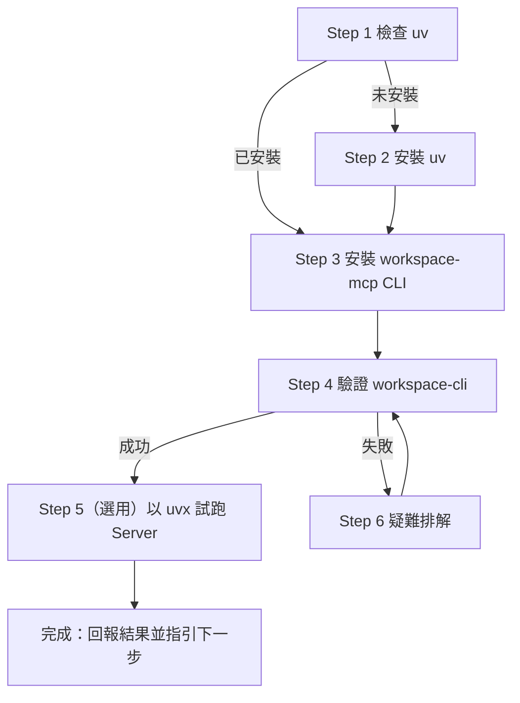

# workspace-mcp 與 workspace-cli 安裝指引（給 AI Agent）

本文件引導 AI Agent 協助使用者安裝 `workspace-mcp` 與 `workspace-cli`。

**內容來源（權威參考）**：<https://github.com/taylorwilsdon/google_workspace_mcp>

> **範圍**：僅涵蓋安裝與安裝驗證。
>
> **遇到問題時**：Agent 必須先查閱上述 GitHub 專案（README 與 Issues），以及 README 所連結的官方文件：
> - Quick Start：<https://workspacemcp.com/quick-start>
> - FAQ 與疑難排解：<https://workspacemcp.com/welcome/faq>
> - 完整文件：<https://workspacemcp.com/docs>
>
> 不得在未查閱的情況下憑猜測給出解法。

---

## Agent 行為準則

- 以**繁體中文（台灣）**回覆使用者。
- 每個步驟先執行檢查，再決定是否需要動作；已安裝者不要重複安裝。
- 安裝套件前，簡短告知使用者即將執行的指令。
- 任一步驟失敗時，先回報錯誤訊息與原因，**不得跳過**後續驗證，並依「Step 6」查閱 GitHub 專案與官方 FAQ。
- 不要在對話中要求使用者貼上金鑰或 Client Secret（那屬於後續 `.env` 設定）。

---

## 流程總覽



---

## Step 1 — 檢查 `uv` 是否已安裝

```bash
uv --version
```

| 結果 | 動作 |
| :--- | :--- |
| 顯示版本號 | 進入 Step 3 |
| `command not found` | 進入 Step 2 |

---

## Step 2 — 安裝 `uv`（僅在未安裝時）

先詢問使用者偏好的安裝方式（macOS 常見為 Homebrew 或官方安裝腳本）：

```bash
# 方式 A：Homebrew
brew install uv

# 方式 B：官方安裝腳本
curl -LsSf https://astral.sh/uv/install.sh | sh
```

安裝後重新執行 `uv --version` 確認。若仍找不到指令，請使用者重開終端機或重新載入 shell 設定檔（如 `source ~/.zshrc`）。

---

## Step 3 — 安裝 `workspace-mcp`（含 `workspace-cli`）

先檢查是否已安裝：

```bash
uv tool list | grep workspace-mcp
```

未安裝則執行：

```bash
uv tool install workspace-mcp
```

> 此指令會將 `workspace-cli` 持久安裝到本機，之後可隨時呼叫（`workspace-cli` 為 `workspace-mcp` 套件提供的指令，見專案 `pyproject.toml` 的 `[project.scripts]`）。

> ⚠️ **不要使用 `uvx workspace-cli`**：PyPI 上有一個已廢棄的同名套件，會裝到錯誤的東西。請一律安裝 `workspace-mcp`。

若已安裝但需要升級：

```bash
uv tool upgrade workspace-mcp
```

---

## Step 4 — 驗證安裝

```bash
workspace-cli --help
workspace-cli call --help
```

**成功判準**：兩個指令皆能輸出說明文字（含支援的子命令與參數格式），且無錯誤。

若出現 `command not found: workspace-cli`，進入 Step 6。

---

## Step 5 —（選用）以 `uvx` 試跑 MCP Server

`uvx` 可一次性執行 Server，首次執行會自動下載最新版本：

```bash
uvx workspace-mcp --tool-tier core
```

- 僅用於確認套件可正常啟動；看到 Server 啟動訊息後即可以 `Ctrl+C` 結束。
- 正式啟動（Streamable HTTP、OAuth 憑證）請依 GitHub 專案 README 的 Quick Start 進行。
- 此指令為長時間執行程序，Agent 若自行執行，應使用背景模式或設定逾時，避免阻塞。

---

## Step 6 — 疑難排解

**遇到下表以外的問題，或下表處理後仍失敗時，Agent 必須依序查閱：**

1. GitHub 專案 README 與 Issues：<https://github.com/taylorwilsdon/google_workspace_mcp>
2. 官方 FAQ 與疑難排解：<https://workspacemcp.com/welcome/faq>
3. 官方完整文件：<https://workspacemcp.com/docs>

查閱後，向使用者說明參考了哪個頁面、問題原因與建議的解法，再動手修正。

| 症狀 | 可能原因 | 處理方式 |
| :--- | :--- | :--- |
| `uv: command not found` | 尚未安裝，或 PATH 未更新 | 回到 Step 2；重開終端機 |
| `workspace-cli: command not found` | `uv tool` 的 bin 目錄不在 PATH | 執行 `uv tool update-shell`，然後重開終端機 |
| `uv tool install` 網路錯誤 | 網路或代理限制 | 回報錯誤原文，請使用者確認網路後重試 |
| 安裝成功但版本過舊 | 本機快取 | 執行 `uv tool upgrade workspace-mcp` |

---

## 完成後回報範本

安裝驗證通過後，向使用者回報：

```text
✅ workspace-mcp 與 workspace-cli 已安裝完成
- uv 版本：<版本>
- workspace-cli --help：正常輸出

下一步：
1. 設定 Google OAuth 憑證（參考 GitHub README 的 Quick Start）
2. 啟動 MCP Server（Streamable HTTP）
3. 設定 MCP Client（參考 README 的 Connect Your Client）
4. 以 workspace-cli list 測試連線
需要我繼續協助嗎？
```

---

## 指令速查

| 目的 | 指令 |
| :--- | :--- |
| 檢查 uv | `uv --version` |
| 安裝 CLI | `uv tool install workspace-mcp` |
| 升級 CLI | `uv tool upgrade workspace-mcp` |
| 一次性執行 Server | `uvx workspace-mcp --tool-tier core` |
| 主命令說明 | `workspace-cli --help` |
| `call` 子命令說明 | `workspace-cli call --help` |
